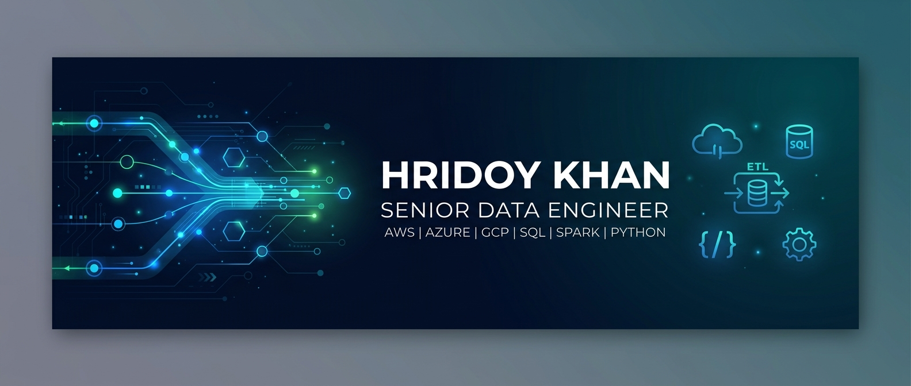
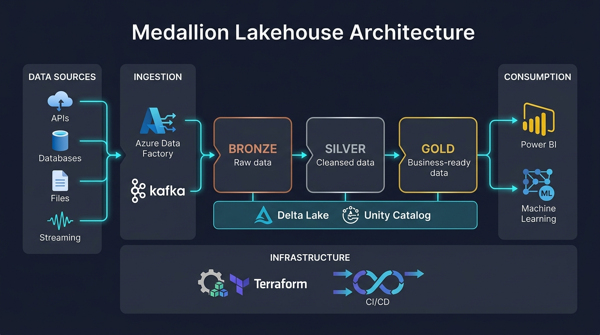

<div align="center">
<br/>
<!-- ANIMATED TYPING SVG — Auto-updates, zero maintenance -->
<a href="https://git.io/typing-svg"></a>
<br/>

<!-- BANNER IMAGE — Upload banner.jpg to your repo's assets/ folder -->


<br/>

<!-- SOCIAL BADGES -->
[](https://linkedin.com/in/YOUR-LINKEDIN)
[](https://hridoy1335.github.io/portfolio)
[](mailto:YOUR-EMAIL@gmail.com)


</div>

## 🛠️ Tech Stack & Expertise

<div align="center">

<!-- SKILL ICONS — One-liner, auto-renders beautiful icons -->
<a href="https://skillicons.dev">
  
</a>

</div>

<br/>

<table align="center">
<tr>
<td align="center" width="50%">

### ☁️ Cloud & Infrastructure


</td>
<td align="center" width="50%">

### 🔥 Data Engineering


</td>
</tr>
<tr>
<td align="center" width="50%">

### 💻 Languages & Querying


</td>
<td align="center" width="50%">

### 🚀 DevOps & CI/CD


</td>
</tr>
<tr>
<td align="center" width="50%">

### 🗄️ Storage & Formats


</td>
<td align="center" width="50%">

### 📊 Analytics & Governance


</td>
</tr>
</table>

---

## 🏛️ Medallion Lakehouse Architecture

<div align="center">

<!-- ARCHITECTURE DIAGRAM — Upload architecture.jpg to your repo's assets/ folder -->


</div>

<br/>

<div align="center">
<table>
<tr>
<td align="center">

**🟤 Bronze**<br/>
Raw Ingestion<br/>
<sub>Schema-on-read • Append-only • Full history</sub>

</td>
<td align="center">➡️</td>
<td align="center">

**⚪ Silver**<br/>
Cleansed & Conformed<br/>
<sub>Deduplication • Type casting • Data quality</sub>

</td>
<td align="center">➡️</td>
<td align="center">

**🟡 Gold**<br/>
Business-Ready<br/>
<sub>Aggregations • Star schema • KPI metrics</sub>

</td>
</tr>
</table>
</div>

---

## 📌 Featured Projects

<table>
<tr>
<td width="50%">

### 🔥 [Databricks Asset Bundle](https://github.com/hridoy1335/databricks_asset_bundle)
Production-grade **Databricks Asset Bundle** deployment with automated CI/CD pipelines across dev/staging/prod environments.

`Databricks` `Python` `DABs` `GitHub Actions` `Delta Lake`

⭐ **Highlights:** Multi-environment deployment, automated testing, asset bundle best practices

</td>
<td width="50%">

### ☁️ [Azure Terraform Data Pipeline](https://github.com/hridoy1335/azure-terraform-data-pipeline)
End-to-end **Infrastructure-as-Code** for Azure data platform with private networking, security controls, and automated provisioning.

`Terraform` `Azure` `HCL` `ADLS Gen2` `Key Vault`

⭐ **Highlights:** Private endpoints, RBAC, modular Terraform, state management

</td>
</tr>
<tr>
<td width="50%">

### 🔄 [End-to-End Data Pipeline](https://github.com/hridoy1335/End-to-End-Data-Pipeline)
Multi-environment **(dev/prod)** Lakehouse pipeline with automated deployment, Delta Lake transformations, and data quality checks.

`PySpark` `Databricks` `Delta Lake` `CI/CD` `Azure`

⭐ **Highlights:** Medallion architecture, environment promotion, automated deployment

</td>
<td width="50%">

### 🛒 [Amazon Sales Analytics](https://github.com/hridoy1335/amazon-sales-project)
Large-scale **e-commerce data processing** pipeline with Silver/Gold zone transformations and business analytics layer.

`PySpark` `Delta Lake` `Python` `Azure Databricks`

⭐ **Highlights:** Complex transformations, aggregation pipelines, analytics-ready output

</td>
</tr>
<tr>
<td width="50%">

### 🏪 [Retail Data Platform](https://github.com/hridoy1335/retail-project)
**Medallion architecture** pipeline for retail analytics with automated data quality checks and business KPI generation.

`Python` `Databricks` `Azure` `Delta Lake`

⭐ **Highlights:** Domain-specific modeling, data quality framework, retail KPIs

</td>
<td width="50%">

### 🏗️ [Terraform Modules](https://github.com/hridoy1335/terraform)
Reusable **Terraform modules** for cloud infrastructure provisioning across AWS and Azure with best practices.

`Terraform` `HCL` `AWS` `Azure` `IaC`

⭐ **Highlights:** Modular design, multi-cloud support, production-ready templates

</td>
</tr>
</table>

---

## 📈 GitHub Analytics

<div align="center">


<!-- CONTRIBUTION GRAPH -->
<div align="center">

[](https://github.com/hridoy1335)

</div>

---

## 🏆 Certifications & Credentials

<div align="center">

<!-- Replace with your ACTUAL certifications. Remove any you don't have. -->


</div>

---

<div align="left">

## 💡 Core Competencies
  
```
Data Platform Architecture    ████████████████████  Expert
Databricks & Spark            ████████████████████  Expert
Delta Lake & Lakehouse        ███████████████████░  Advanced
Terraform & IaC               ███████████████████░  Advanced
Azure Cloud Services          ████████████████████  Expert
CI/CD & DevOps                ██████████████████░░  Advanced
Data Modeling (Star/Snow)     ██████████████████░░  Advanced
Python & PySpark              ████████████████████  Expert
Data Quality Engineering      █████████████████░░░  Advanced
Streaming (Kafka/Event Hub)   ████████████████░░░░  Proficient
```

</div>

---

<div align="left">
  
## 🧑‍💻 About Me

```yaml
name: Hridoy Khan
role: Senior Data Engineer
location: Bangladesh
focus: Enterprise Lakehouse Platforms & Cloud Data Architecture

experience:
  - Building production-grade data pipelines processing millions of records daily
  - Designing multi-environment Lakehouse architectures (Bronze → Silver → Gold)
  - Automating cloud infrastructure with Terraform & Databricks Asset Bundles
  - Implementing DataOps practices with CI/CD, testing, and monitoring

currently_building: "Multi-cloud Lakehouse platforms with Databricks & Delta Lake"
learning: "Apache Iceberg, dbt, Kafka Streams, Data Mesh patterns"
passionate_about: "Data quality engineering, platform reliability, DataOps"
```

</div>

---

## 📬 Let's Connect

<div align="center">

**I'm open to collaborating on data engineering projects, speaking at conferences, and discussing cloud data architecture.**

[](https://linkedin.com/in/YOUR-LINKEDIN)
[](mailto:YOUR-EMAIL@gmail.com)
[](https://hridoy1335.github.io/portfolio)

</div>

---

<div align="center">


</div>
