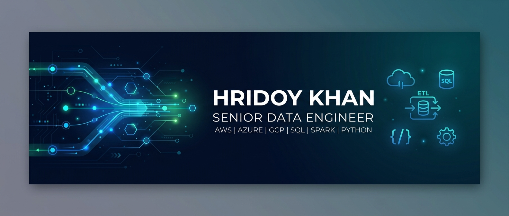
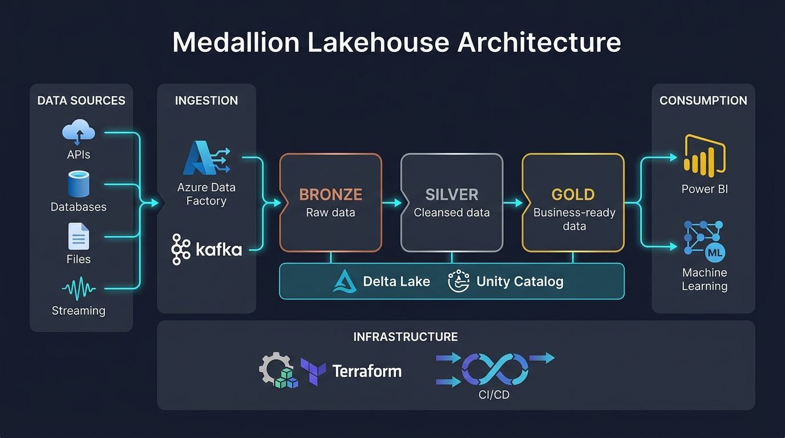

---

### Azure Data Engineer

Building cloud data platforms with **Azure Databricks, Apache Spark, Python, SQL and Delta Lake.**

### Technology Stack

 

---

### Featured Projects

<table>
<tr>
<td width="50%" valign="top">

### [TelcoPulse Lakehouse ↗](https://github.com/hridoy1335/telcopulse-lakehouse)

**End-to-end Telecom Data Platform**

- PostgreSQL batch ingestion
- 50K+ synthetic events daily
- Azure Event Hubs
- Bronze / Silver / Gold
- Star Schema & SCD Type 2
- DAB & OIDC CI/CD

</td>
<td width="50%" valign="top">

### [Databricks Asset Bundle ↗](https://github.com/hridoy1335/databricks_asset_bundle)

**Databricks Deployment Automation**

- Declarative pipeline structure
- Environment-based deployment
- PySpark
- Unity Catalog
- GitHub Actions

</td>
</tr>
</table>

---

### Lakehouse Architecture

---

### Let's Connect

**Open to Azure Data Engineering opportunities and technical collaboration.**

